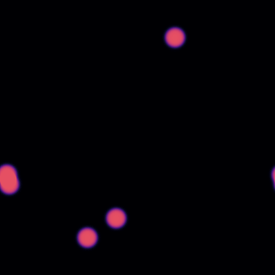
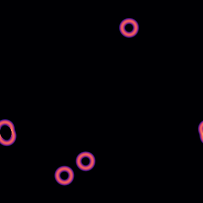

# CoolBubble

CoolBubble is a lattice code for the classical dynamics of a scalar field
during a first-order phase transition, from the nucleation of critical bubbles to the late-time evolution after their collisions. It runs in one, two and three spatial dimensions, in a static or, for $d=3$, a self-consistently expanding background. We consider only vacuum bubbles.

The code was developed for
[arXiv:2607.19469](https://arxiv.org/abs/2607.19469). It is written in C++
and parallelised with OpenMP. It might not be the most optimised code, but it is self-contained and simple to read, adjust and extend: feel free to use it and play around.

## Example

<p align="center">
  
  
</p>

*Five bubbles colliding in 2+1 dimensions (*
$L=32 v_\phi^{-1}$, $N=512$, $c_\phi=4$,
*static background). Left: the field, from the false vacuum (black) to the true vacuum (orange). Right: the gradient energy density on a logarithmic scale. It is concentrated in the contracting walls and remains in propagating shells after the collisions.*


## Quick start

```bash
make
./coolbubble --out runs/
```

This runs five randomly nucleated bubbles in a $(2+1)$-dimensional box with the
default parameters of [`src/def.h`](src/def.h) and writes the data, the plots
and a video to a new folder in `runs/`.

## Installation

**Requirements**
- a C++17 compiler with OpenMP (e.g. `g++`)
- [FFTW3](http://www.fftw.org/) and [HDF5](https://www.hdfgroup.org/solutions/hdf5/) with its C++ library
- for the plots: Python 3 with `numpy`, `scipy`, `matplotlib`, `seaborn`, `h5py`, and optionally `ffmpeg` for the videos (the plots can be switched off with `--no-plots`)

`make` builds the executable `coolbubble`. If FFTW or HDF5 are not in the system
paths, pass their location, `make HDF5_DIR=/path/to/hdf5 FFTW_DIR=/path/to/fftw`,
or write these two lines into a file `make.local` next to the makefile. On
clusters, `make CXX=h5c++` usually works. Optimisation flags can be set with
`make CXXFLAGS="-O3 -march=native"`.

## Running

```bash
./coolbubble [options]
```

| Option | Meaning | Default |
|---|---|---|
| `--D <1\|2\|3>` | number of spatial dimensions $d$ | 2 |
| `--L <value>` | box size $L$ | 32 |
| `--nGrids <n>` | grid points per dimension $N$ | 512 |
| `--nt <n>` | number of time steps | 1000 |
| `--c <value>` | potential parameter $c_\phi$ | 4 |
| `--mode <m>` | initial condition in $d=2,3$ (see below) | 1 |
| `--snapshots <n>` | number of field snapshots, besides the initial one | 20 |
| `--out <dir>` | folder in which the run folder is created | `./` |
| `--no-plots` | no Python plots | |
| `--help` | list of all options | |

All other settings, such as the time step $\Delta t$, the number of bubbles, the
expansion, the output and the wall tracking, are compile-time constants in
[`src/def.h`](src/def.h): edit the file and run `make` again. The time
evolution is only stable for $\Delta t < \Delta x/\sqrt{d}$, with $\Delta x = L/N$;
the program checks this condition before starting.

## The simulation

**Potential and units.** All program variables are dimensionless and expressed
in units of $v_\phi$, the vacuum expectation value in the true minimum. The
potential is

$$V(\phi) = c_\phi \phi^2 - (2c_\phi+4) \phi^3 + (c_\phi+3) \phi^4 + \Delta V ,$$

with the true vacuum at $\phi = 1$, where $V=0$, and the false vacuum at
$\phi=0$, which carries the latent heat $\Delta V = v_\phi^{d+1} = 1$. The
parameter $c_\phi$ sets the height of the barrier: large values give thin
walls, small values thick ones. The plots show lengths and times in units of
$m_\phi^{-1}$, with $m_\phi = \sqrt{2(c_\phi+6)} v_\phi$ the mass in the true
vacuum.

**Evolution.** With the canonical momentum $\Pi \equiv a^d\dot\phi$, the field
obeys $\dot\phi = a^{-d} \Pi$ and $\dot\Pi = a^{d-2}\nabla^2\phi - a^d V'(\phi)$
on a periodic grid, with the Laplacian replaced by second-order finite
differences. The equations are integrated with a leapfrog scheme, in which
$\phi$ and $a$ live at integer and $\Pi$ and $\dot a$ at half-integer time
steps. In $d=3$, the scale factor can be evolved with the second Friedmann
equation, sourced by the field itself (`expansion 1` in `def.h`), with the
reduced Planck mass `Mpl` setting the strength of the expansion. Conformal time
is available as well (`ALPHAVAL 1`).

**Initial conditions.** The field starts at rest in the false vacuum, except
inside the nucleated bubbles, whose $\tanh$ profile follows fits to the
critical profile as a function of $c_\phi$, obtained with the public code
[*BubbleProfiler*](https://github.com/bubbleprofiler/bubbleprofiler). In $d=3$, these fits seem to underestimate the critical radius, so the bubbles are nucleated with $1.3$ times the fitted radius.
Updated bubble profiles will follow in the next version. In $d=1$, a bubble is nucleated at
the edge of the box and collides with its periodic image in the centre. In
$d=2,3$, `--mode` selects

| Mode | Initial condition |
|---|---|
| `-2` | a single bubble in the centre of the box |
| `-1` | two bubbles on the diagonal of the box |
| `1` | `nBubbles` bubbles at random positions (completed by their periodic images at the boundaries) |
| `0` | bubbles at the positions listed in `<run folder>/__xns.dat` |
| `-3` | thermal fluctuations around the false vacuum, with temperature set by `Trad` |

**Observables.** The code tracks the volume-averaged kinetic, gradient and
potential energy densities, from which the equation of state
$w = \bar P/\bar\rho$ follows, as well as the averages of $\phi$ and
$\dot\phi$. At each snapshot it saves the field and computes its power
spectrum

$$\Delta_\phi(k) = \frac{k^d}{2^{d-1}\pi^{d/2} \Gamma(d/2)} \frac{\langle|\tilde\phi(k)|^2\rangle}{L^d} ,
\qquad \langle\phi^2\rangle = \int \Delta_\phi(k)  \mathrm{d}\ln k ,$$

which for $d=3$ reduces to $k^3\langle|\tilde\phi(k)|^2\rangle/(2\pi^2 L^3)$.
Optionally (`WallTracking 1`), the code follows the width of a bubble wall
between the top of the barrier and the exit point of the bounce, and infers
the Lorentz factor of the wall from its contraction. This works best in $d=1$;
in $d=2,3$ it is available for a single bubble.

**Accuracy.** In a static background the total energy is conserved, and in an
expanding one the first Friedmann equation, which is not imposed, serves as a
constraint. Both are written to `EnergyDensities.dat` and shown in the summary
plots, and should stay small, of order $\Delta t^2$.

## Output and plots

Each run creates a folder named after its main parameters, e.g.
`Sim2_D_nt_8000_dt_0.00400_nGrids_512_L_32.0_Mode_1_...`, containing

| File | Content |
|---|---|
| `parameters.dat` | all parameters of the run |
| `EnergyDensities.dat` | volume-averaged energies, field averages and Hubble rate over time |
| `_phi_t=NNNN.h5` | field snapshots: $\phi$ and $\Pi$ as arrays of shape $N^d$ (thinned on very large lattices), with $t$, $a$ and the run parameters as attributes |
| `_phi_k_t=NNNN.dat` | power spectrum at each snapshot: comoving $k$, physical $k$ and $\Delta_\phi(k)$ |
| `__xns.dat`, `gamma.dat`, `FullField.dat` | bubble positions, wall tracking, and the full field over time in $d=1$ |

During a run, `python/plot_FieldAndPowerSpectrum.py` plots every snapshot
(switched off with `plotsnapshots 0`), and at the end
`python/plot_SummaryPlots.py` plots the energies, the equation of state, the
evolution of the power spectrum and, in $d=2$, maps of the kinetic and gradient
energy density on a common logarithmic colour scale. The snapshots and the
energy maps are also turned into videos. To redo the plots of an existing run,
e.g. after changing a plotting script, use

```bash
python3 python/replot.py runs/Sim2_D_...
```

## Repository layout

| Path | Content |
|---|---|
| `src/def.h` | compile-time parameters and defaults |
| `src/main.cpp` | command-line options, run folder and time loop |
| `src/bubble.hpp`, `src/bubble.cpp` | the `Bubble` class: initial conditions, evolution, observables and output |
| `src/gridfuncs.h`, `src/gridfuncs.cpp` | periodic lattice indexing |
| `python/` | plotting scripts |

## Limitations

- The expansion is only implemented in $d=3$; in other dimensions the
  Friedmann equations would first have to be generalised.
- The wall tracking needs a high resolution, since the measured region covers
  only a small part of the wall.
- The code is not optimised for very large lattices. Our largest runs used
  $1200^3$ grid points.

## License

CoolBubble is free software, released under the
[GNU General Public License v3](LICENSE) or (at your option) any later version.

## Citation

CoolBubble was written by Henda Mansour and Yann Gouttenoire. If you use it in
academic work, please cite

H. Mansour, Y. Gouttenoire and F. Kahlhoefer, *Can the universe be
matter-dominated after a supercooled first-order phase transition?*,
[arXiv:2607.19469](https://arxiv.org/abs/2607.19469) [hep-ph].

```bibtex
@article{Mansour:2026sdx,
    author = "Mansour, Henda and Gouttenoire, Yann and Kahlhoefer, Felix",
    title = "{Can the universe be matter-dominated after a supercooled first-order phase transition?}",
    eprint = "2607.19469",
    archivePrefix = "arXiv",
    primaryClass = "hep-ph",
    reportNumber = "TTP26-031, P3H-26-059",
    month = "7",
    year = "2026"
}
```

## Contact

Comments and questions are welcome: Henda.mansour@kit.edu
